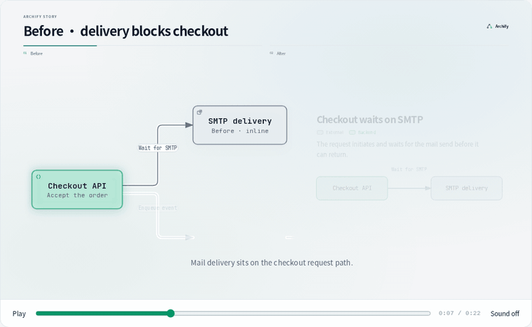

# Archify Release Promotional Film (Remotion)

用纯代码（React + SVG + 3D 透视投影 + 程序化音频合成 + Remotion）制作的 **Archify 发版宣传片**，聚焦本次发版的两大核心能力：**确定性代码分析（Code Analysis）** 与 **动态演示引擎（Story Choreography）**。

- **分辨率 / 帧率**：`1920 × 1080` · `30 fps` · `3380 帧 (~112.7 秒)`
- **视觉语言**：对齐 `archify.si` 官方亮色建筑纸设计系统（`#F5F6F3` 暖纸底、64px 制图网格、`#E2500E` 焰橙、`#0856F5` 钴蓝、`#1DBBB7` 青绿），并在全仓星盘与 3D 粒子树专场切入高对比科幻暗色舞台。
- **零外部视频/音频素材依赖**：离线内置字体（`JetBrains Mono` / `Space Grotesk` / `Inter`），全套立体声 BGM 与 10 类动效音效由 [`scripts/generate-audio.mjs`](scripts/generate-audio.mjs) 确定性合成。

## 用 Archify 演示 Archify

**原版 Story 在已有图上做讲解；Story Choreography 把讲解扩展到多种原生图结构，还能跨图转场。** 前两张是 Archify v3.3.0 直接导出的动态 SVG，按系统切换深浅色；第三张是原版播放器的片段。

### 01 / 缓存未命中：让现有时序图动起来

沿用 [Archify 的缓存未命中示例](https://archify.si/gallery/artifacts/cache-miss.sequence.html)，把 Redis 未命中、Postgres 回源、写回缓存分成三拍。每一拍依次揭开新消息并追踪流向，后续路径不提前出现。镜头跟着当前路径切换取景。

<picture>
  <source media="(prefers-color-scheme: dark)" srcset="docs/story-demos/cache-miss/cache-miss-dark.svg">
  
</picture>

[时序图 JSON](docs/story-demos/cache-miss/cache-miss.sequence.json) · [编排 JSON](docs/story-demos/cache-miss/cache-miss.story.json)

### 02 / 订单回执：把一次架构改动讲清楚

这是一个假想 PR。结账 API 在转场中留在原位，同步邮件路径退场，队列和 worker 依次入场。两张图分别使用 Classic 和 Signal Flow 配色，新增点用 NEW 标记，不只靠颜色区分。

<picture>
  <source media="(prefers-color-scheme: dark)" srcset="docs/story-demos/checkout/checkout-dark.svg">
  
</picture>

[变更前](docs/story-demos/checkout/checkout-before.json) · [变更后](docs/story-demos/checkout/checkout-after.json) · [编排 JSON](docs/story-demos/checkout/checkout.story.json)

### 03 / 原版 Story：在一张架构图上分章节讲解

还是上面的结账例子，但这次不换图。原版 Viewer 沿同一张架构图的节点和连线讲解，**字幕在下方**，时间轴可播放、暂停和拖动。README 内是实拍预览，真正的控件在离线 HTML 里。

<picture>
  <source media="(prefers-reduced-motion: reduce)" srcset="docs/story-demos/native/native-story-poster.png">
  
</picture>

[下载原版交互播放器与脚本](docs/story-demos/native/checkout-native-story.zip?raw=true) · 解压后打开 `checkout-flow.story.html`，切换 **Motion → Story**。

[Story 编排与导出文档 ↗](https://github.com/tt-a1i/archify/blob/v3.3.0/archify/references/story-authoring.md)

## 六幕结构

| 合成 ID | 主题 | 核心画面与动效 |
| --- | --- | --- |
| `ArchifyReleasePromo` | **完整主片（112.7s）** | 全六幕无缝串联 + 纯振幅交叉淡入淡出 BGM 与逐帧卡点音效 |
| `ArchifyReleasePromoEN` | English full film | Same scenes, timing and soundtrack with English on-screen copy |
| `ArchifyReleasePromo60` / `ArchifyReleasePromo60EN` | **60 秒社交版（中 / 英）** | 从六幕中各取最强镜头剪成 13 段；隐藏原长字幕，每段改用一句短字幕；音效随片段自动对位 |
| `01-CognitiveDebt` | **AI 时代与绿色 CI 幻觉** | Archify 蓝图装配式品牌开场 → Prompt 与 `CI 全绿` 假象 → 三层 Clean Architecture 绿灯下静默漂移 + 指标对照 → 「我们做了什么」悬浮转折 → 现存 9 个漂移节点直接裂变并连同图纸背景黑化变形为 Atlas 星盘 |
| `02-CodeAnalysisAtlas` | **代码分析三视图** | ① **2D 全仓星盘 Atlas**（18 层余辉雷达扫光实时点亮 `coupling/cycle` / `complexity/function` / `architecture/boundary` / `coupling/internal-leak` 信号 + 六大语言 + 扇区聚焦 + 循环彗星 + PR 差异模式）→ ② **Atlas 3D 粒子树**（2D 底座倾倒消融、480+ 粒子螺旋拔地升维）→ ③ **原版架构图无侵入叠加（`--ir`）**（信任边界、5 色诊断光晕全貌、5 色图例条 + 右侧 Workbench 优先级清单、内嵌循环/复杂度迷你图、Git Diff 源码边栏与 `Accept Baseline`） |
| `03-StoryChoreography` | **动态演示引擎（Pulse Billing #5）** | 原生 10 种图结构 → 「为什么不让 AI 直接手写动效？」对照揭秘（`choreography.json` 声明式意图 → 自动相机 / Git SHA 校验 / 直入 PR 与视频流）→ Pulse Billing #5 实机演示（架构图同源变身时序图 + `src/routes/checkout.ts:19-34 @ 8bcb443` 真实源码 + `db/schema.sql` UUID / `bigint` / `UNIQUE(idempotency_key)` ERD） |
| `04-RealCases-Tokio-Vue` | **真实开源 PR 双连击** | **Tokio #1657** 批量窃取到 Worker 生命周期横摇运镜 → 斜切光带转场 → **Vue #2532** 微距推镜裂开 `processExpression() 22→22` 揪出嵌套 `prefix(raw: string) 2→6`（锚定真实 `transformExpression.ts:101-114 @ 2a4fc32d`） |
| `05-WorkflowAndDeliverables` | **全形态交付 × AI 修复闭环** | 双主题无脚本 Camo-safe SVG 斜切对照（GitHub PR / GitLab MR · 4 预设 Stage · 1080p60 素材无缝并入 Remotion / 剪辑流）→ 镜头跟随 4 步工程闭环（Atlas 诊断 → Copy Task for AI → Coding Agent 修复 → Re-analyze 验绿） |
| `06-MetaOutro` | **自举收尾与品牌定格** | `Typed JSON IR → Deterministic Gate → Story Choreography → SVG / Stage / MP4` 拉远收束 → 官方亮色 Archify Lockup 扫光定格 |

## 快速开始

```bash
npm install

# 启动本地 Remotion Studio 实时预览（首次会自动合成 public/audio/*.wav）
npm run studio

# 单独重新合成全部 BGM 与音效
npm run audio

# TypeScript 类型检查
npm run typecheck

# 导出 1080p MP4 成片（输出至 out/archify-release-promo.mp4）
npm run build
```

## English edition

In Remotion Studio, choose `ArchifyReleasePromoEN` for the full English-language film. It shares the Chinese edition's scene sequence, timing and synthesized soundtrack. Original repository names, paths, identifiers and code citations are retained. The default `ArchifyReleasePromo` composition and `npm run build` remain Chinese.

To render the English edition locally when needed, run `npm run build:en`. Its output is `out/archify-release-promo-en.mp4`.

### 60 秒社交版

`npm run build:60` 与 `npm run build:60:en` 分别输出 `out/archify-release-60s.mp4` 和 `out/archify-release-60s-en.mp4`。剪辑表在 [`src/cut/clips.ts`](src/cut/clips.ts)：每段是某一幕内的帧区间 `[from, to)` 加一句中英短字幕，改帧号即可重剪，不需要动各幕代码。音效按幕内帧号登记在 `SoundTrack.tsx`，落在保留片段内的会自动挪到新时间线上。

### 平台封面与视频：X

封面在 [`src/covers/XCover.tsx`](src/covers/XCover.tsx)，16:9，三个方案各有中英两版，背景是片中真实画面：

| 方案 | 背景 | 中文标题 | English headline |
| --- | --- | --- | --- |
| `atlas` | 2D 全仓星盘 | CI 全绿，架构早已面目全非 | Green CI. Drifting architecture. |
| `tree` | 3D 粒子树 | 整个代码库，一眼看清结构 | Your whole repo, mapped in 3D. |
| `drift` | PR #47 架构漂移 | 47 个 PR 测试全绿，架构悄悄走样 | 47 PRs. All green. Architecture: drifted. |

```bash
npx remotion still src/index.ts XCover-atlas-zh out/x/cover-atlas-zh.png
npx remotion render src/index.ts XPromo-en out/x/archify-x-en.mp4
```

`XPromo-zh` / `XPromo-en` 是 60 秒版前加 20 帧封面再淡入正片，首帧就是封面，缩略图取首帧时不必另选。换封面改 [`src/covers/XPromo.tsx`](src/covers/XPromo.tsx) 里的 `X_VIDEO_COVER`。

### 平台封面与视频：小红书

[`src/covers/Xiaohongshu.tsx`](src/covers/Xiaohongshu.tsx)，3:4 竖版（1080 × 1440），只做中文。

- 封面 `XhsCover-atlas`（深色星盘，「CI 全绿，架构早已面目全非」）与 `XhsCover-drift`（浅色漂移卡片，「47 个 PR 测试全绿，架构悄悄走样」）。
- 视频 `XhsVideo`：顶部固定标题「AI 写的代码，架构还好吗？」，中间是 60 秒版，下方用大号字幕。小红书发布时可单独上传封面，所以视频不内嵌封面帧。

```bash
npx remotion still src/index.ts XhsCover-atlas out/xiaohongshu/cover-atlas.png
npx remotion render src/index.ts XhsVideo out/xiaohongshu/archify-xiaohongshu.mp4
```

## 关联仓库

- Archify 主仓库：https://github.com/tt-a1i/archify
- PR 动态讲解案例仓库：https://github.com/tt-a1i/pr-lens-demo
